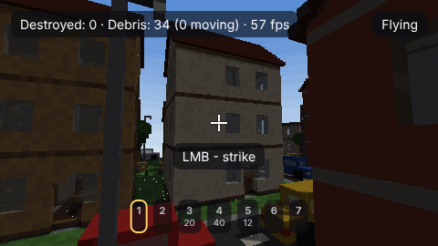
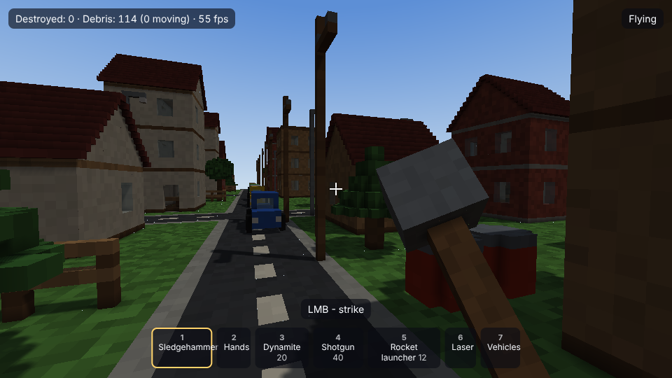
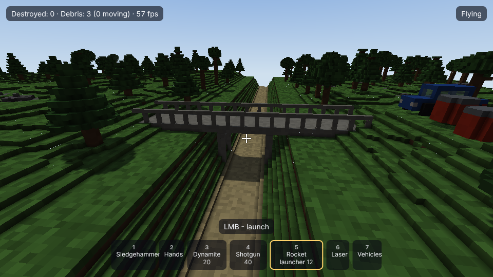
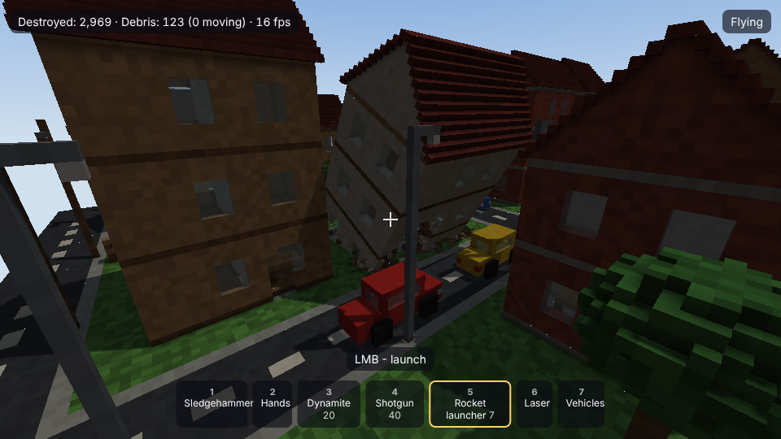
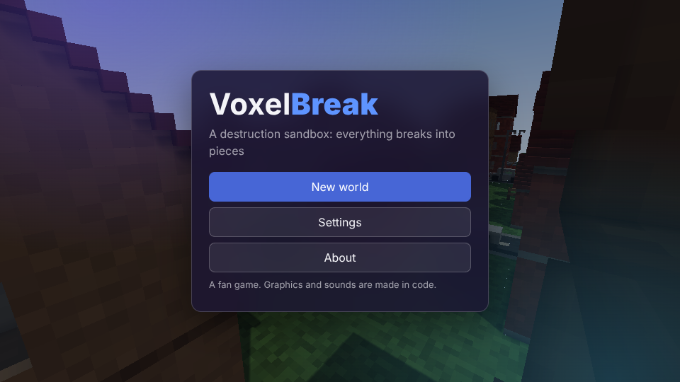

# VoxelBreak

**English** · [Русский](README.ru.md)

[](CHANGELOG.md) [](https://github.com/ALEXalesha/VoxelBreak/actions/workflows/ci.yml) [](LICENSE) [](https://developer.mozilla.org/docs/Web/JavaScript) [](https://threejs.org/) [](https://www.electronjs.org/) [](https://alexalesha.github.io/VoxelBreak/) [](https://claude.com/claude-code)

Code, tests and docs are written by Claude (Anthropic) in Claude Code; ideas, testing and decisions - Alexey.

A destruction sandbox in a voxel world, in the browser and as a desktop app. Everything is made of
small cubes (25 cm) and breaks for real: a piece that loses its support comes off as its own body and
falls by physics, debris piles up, rolls and goes to sleep. Sledgehammer, hands, dynamite, explosive
barrels with chain reactions, a shotgun, a rocket launcher, a laser, a car, a bulldozer and a crane with a
wrecking ball. Every world is new: a town, nature with a ravine and a bridge, or both, generated from a seed.

A fan game. The name, graphics and sounds are its own - all drawn and synthesised in code; it is not
affiliated with the makers of any other destruction game.



| Town | Nature and the bridge |
| --- | --- |
|  |  |

| After the explosions | Menu (glass and light themes) |
| --- | --- |
|  |  |

## Controls

| Key | Action |
| --- | --- |
| W A S D | walk (in a vehicle: throttle and steering) |
| Mouse | look (click the game to capture the mouse) |
| Left button | strike, shoot, place, cut (hold the laser) |
| Right button | hands: grab and carry; vehicles: switch the type |
| 1 - 7 or wheel | sledgehammer, hands, dynamite, shotgun, rocket launcher, laser, vehicles |
| Space / C | jump / crouch (in flight: up / down) |
| Shift | run |
| F | fly |
| E | get into the nearest vehicle / leave it |
| V | third-person view |
| Esc | pause: save, load, settings |
| F11 | full screen (desktop app) |

All keys except Esc can be reassigned in Settings → Keys. The menu has five themes (glass, formal, light,
night, warm) and two languages (Russian, English).

## How it works

- **Voxels and chunks.** The world is a grid of 32³ chunks, one byte per voxel. Chunk meshes are built by
  greedy meshing with corner ambient occlusion in a Web Worker; the per-voxel colour noise comes from a
  shader hash, so merged faces keep their texture.
- **Honest destruction.** A hit removes voxels by force against material strength. Then a best-first search
  goes from the neighbours of the hole down to the bedrock; whatever cannot reach it is cut out of the world
  and becomes a rigid body with its own voxel grid. The edge of an explosion crater cracks off into small
  flying chunks. Bodies split again when hit.
- **Own physics.** Surface voxels of a body are contact spheres against world voxels and other bodies;
  sequential impulses with friction, sleeping bodies cost nothing. A budget keeps the frame: tiny pieces
  turn to dust, the number of bodies is capped. A body that hits the ground hard cracks at the point of impact.
- **Models through one layer.** Houses, cars, trees, items and vehicles are built in code now
  (`web/assets/proc`), but the game asks only `assets.get(id)`. Changing a line in `web/assets/manifest.js`
  to a `.glb` from Blender swaps the model: triangles are converted to voxels at load time, the material
  is taken from the Blender material name (`brick`, `glass`, `metal`...) or the nearest colour.

## Run

In the browser: https://alexalesha.github.io/VoxelBreak/ (once Pages is enabled), or locally:

```bash
npm ci
```

```bash
npm run serve
```

and open http://127.0.0.1:4173/. Desktop app:

```bash
npm start
```

Windows build (portable and installer):

```bash
npm run dist
```

## Tests

```bash
npm run cover
```

```bash
npm run test:web
```

```bash
xvfb-run -a npm run test:app
```

```bash
npm run mutate
```

- **Laws (node:test, 88):** world generation is deterministic by seed; chunks match at the seams and the
  world does not depend on the chunk order; after any destruction nothing floats unattached; the voxel
  count is conserved (world + bodies + destroyed + dust); an explosion of radius R removes what it should;
  a piece without support falls and lies down; meshes have no holes and no extra faces, each face has the
  material and the corner shade of its voxel; save and load round-trip; GLB models convert to the expected
  voxels; the reference scene with a large destruction stays within the frame budget.
- **Branch coverage (c8):** core 97.9 %, all code without windows 96.7 % (thresholds 90 % and 80 %, checked in CI).
- **Mutants:** `tools/mutate.js` breaks one rule at a time (41 mutants), every law must catch its own; all 41 are killed.
- **Page (Playwright, 18 laws, headless Chromium, WebGL via SwiftShader):** no errors and no network, both languages,
  contrast of all five themes, a 360 px window, key reassignment, saving, vehicles, without a Worker.
- **App (Electron, 4 laws):** the window is never shown and never takes focus, settings and saves survive a restart,
  navigation is blocked, 20 launches in a row without memory growth.
- Pointer lock is only ever a stub in tests.

## Not yet

Models from Blender (houses, vehicles, weapons, a skinned character) - the loading layer is ready, the files
are not. No story, missions, enemies or multiplayer (not planned for now).

## License

MIT
