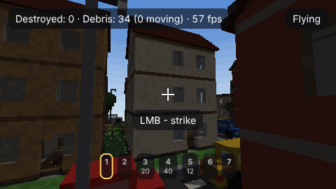
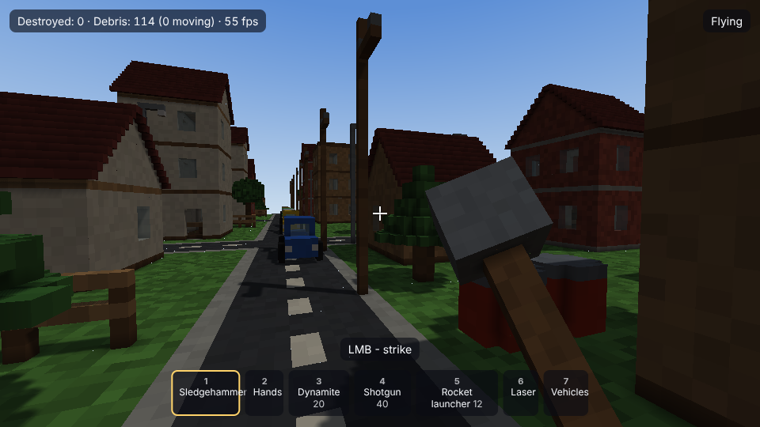
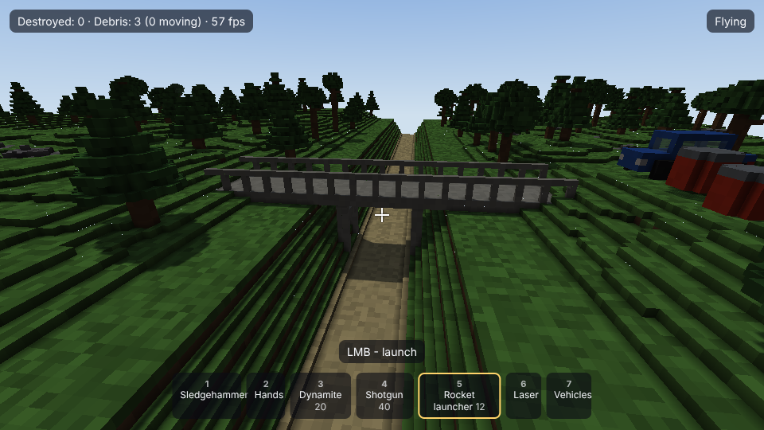
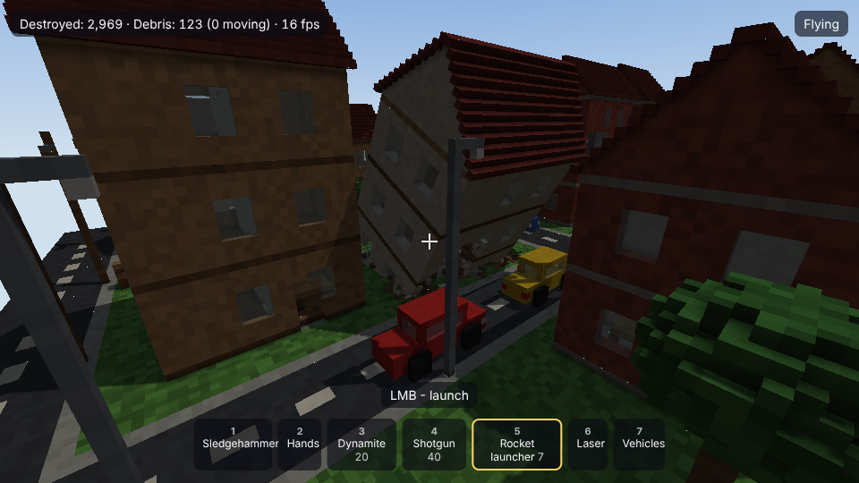
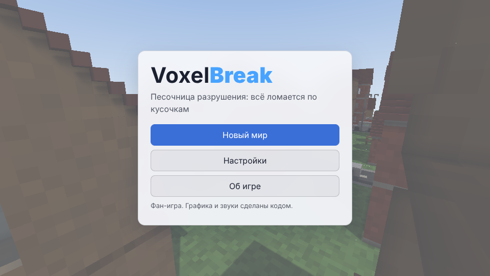

# VoxelBreak

[English](README.md) · **Русский**

[](CHANGELOG.md) [](https://github.com/ALEXalesha/VoxelBreak/actions/workflows/ci.yml) [](LICENSE) [](https://developer.mozilla.org/docs/Web/JavaScript) [](https://threejs.org/) [](https://www.electronjs.org/) [](https://alexalesha.github.io/VoxelBreak/) [](https://claude.com/claude-code)

Код, тесты и документацию написал Claude (Anthropic) в Claude Code; идеи, проверка и решения - Алексея.

Песочница разрушения в воксельном мире, в браузере и как программа для компьютера. Всё состоит из
маленьких кубиков (25 см) и ломается по-настоящему: кусок, потерявший опору, отрывается отдельным телом и
падает по физике, обломки ложатся грудой, катятся и засыпают. Молот, руки, динамит, бочки с горючим и
цепной реакцией, дробовик, ракетница, лазер, машина, бульдозер и кран с шаром. Каждый мир новый: город,
природа с оврагом и мостом или всё вместе - по зерну.

Фан-игра. Имя, графика и звуки свои - всё нарисовано и озвучено кодом; к создателям других игр про
разрушение отношения не имеет.



| Город | Природа и мост |
| --- | --- |
|  |  |

| После взрывов | Меню (стеклянная и светлая темы) |
| --- | --- |
|  |  |

## Управление

| Клавиша | Действие |
| --- | --- |
| W A S D | ходить (в технике: газ и руль) |
| Мышь | смотреть (щелчок по игре захватывает мышь) |
| Левая кнопка | удар, выстрел, поставить, резать (лазер - держать) |
| Правая кнопка | руки: взять и нести; техника: сменить вид |
| 1 - 7 или колесо | молот, руки, динамит, дробовик, ракетница, лазер, техника |
| Пробел / C | прыжок / присесть (в полёте: вверх / вниз) |
| Shift | бег |
| F | полёт |
| E | сесть в ближайшую технику / выйти |
| V | вид от третьего лица |
| Esc | пауза: сохранить, загрузить, настройки |
| F11 | во весь экран (в программе) |

Все клавиши, кроме Esc, переназначаются в Настройках → Клавиши. У меню пять тем (стеклянная, строгая,
светлая, ночная, тёплая) и два языка (русский, английский).

## Как устроено

- **Воксели и чанки.** Мир - решётка чанков 32³, один байт на воксель. Сетка чанка строится жадно,
  с затенением углов, в Web Worker; пёстрость каждого вокселя даёт шейдер по хешу координат, поэтому
  слитые грани не теряют узор.
- **Честное разрушение.** Удар выбивает воксели по силе против прочности материала. Потом от соседей дыры
  идёт поиск «сначала вниз» до коренной породы; что не дошло - вырезается из мира и становится твёрдым
  телом со своей воксельной сеткой. Край воронки взрыва откалывается мелкими кусками и разлетается. По телу
  тоже можно бить - оно раскалывается дальше.
- **Своя физика.** Поверхностные воксели тела - шары касания против вокселей мира и других тел;
  последовательные импульсы с трением, спящие тела ничего не стоят. Бюджет держит кадр: мелочь - в пыль,
  число тел ограничено.
- **Модели через один слой.** Дома, машины, деревья, предметы и техника пока сделаны кодом
  (`web/assets/proc`), но игра просит только `assets.get(id)`. Поменять строку в `web/assets/manifest.js`
  на `.glb` из Blender - и модель подменится: треугольники переводятся в воксели при загрузке, материал
  берётся из имени материала в Blender (`brick`, `glass`, `metal`…) или по ближайшему цвету.

## Запуск

В браузере: https://alexalesha.github.io/VoxelBreak/ (когда включат Pages), или у себя:

```bash
npm ci
```

```bash
npm run serve
```

и открыть http://127.0.0.1:4173/. Программа:

```bash
npm start
```

Сборка под Windows (portable и установщик):

```bash
npm run dist
```

## Проверки

```bash
npm run cover
```

```bash
npm run test:web
```

```bash
xvfb-run -a npm run test:app
```

```bash
npm run mutate
```

- **Законы (node:test, 87):** генерация детерминирована по зерну; чанки совпадают на швах, мир не зависит
  от порядка чанков; после любого разрушения ничего не висит; число вокселей сохраняется (мир + тела +
  выбито + пыль); взрыв радиуса R убирает ожидаемое; кусок без опоры падает и ложится; в сетке нет дыр и
  лишних граней, у каждой грани материал и затенение её вокселя; сохранение туда-обратно; модели GLB дают
  ожидаемые воксели; эталонная сцена с большим разрушением держит бюджет кадра.
- **Покрытие по ветвям (c8):** ядро 97 %, весь код без окон 96 % (пороги 90 % и 80 %, проверяются в CI).
- **Мутанты:** `tools/mutate.js` ломает по одному правилу (39 мутантов), каждый закон ловит свой.
- **Страница (Playwright, Chromium без окна, WebGL через SwiftShader):** без ошибок и сети, оба языка,
  контраст всех пяти тем, окно 360 px, переназначение клавиш, сохранение, техника, работа без Worker.
- **Программа (Electron):** окно никогда не показывается и не берёт фокус, настройки и сохранение переживают
  перезапуск, уйти со страницы нельзя, 20 запусков подряд без роста памяти.
- Захват мыши в проверках - только заглушка.

## Чего пока нет

Модели из Blender (дома, техника, оружие, персонаж со скелетом) - слой загрузки готов, файлов нет. Сюжета,
миссий, противников и мультиплеера нет (пока не планируются).

## Лицензия

MIT
